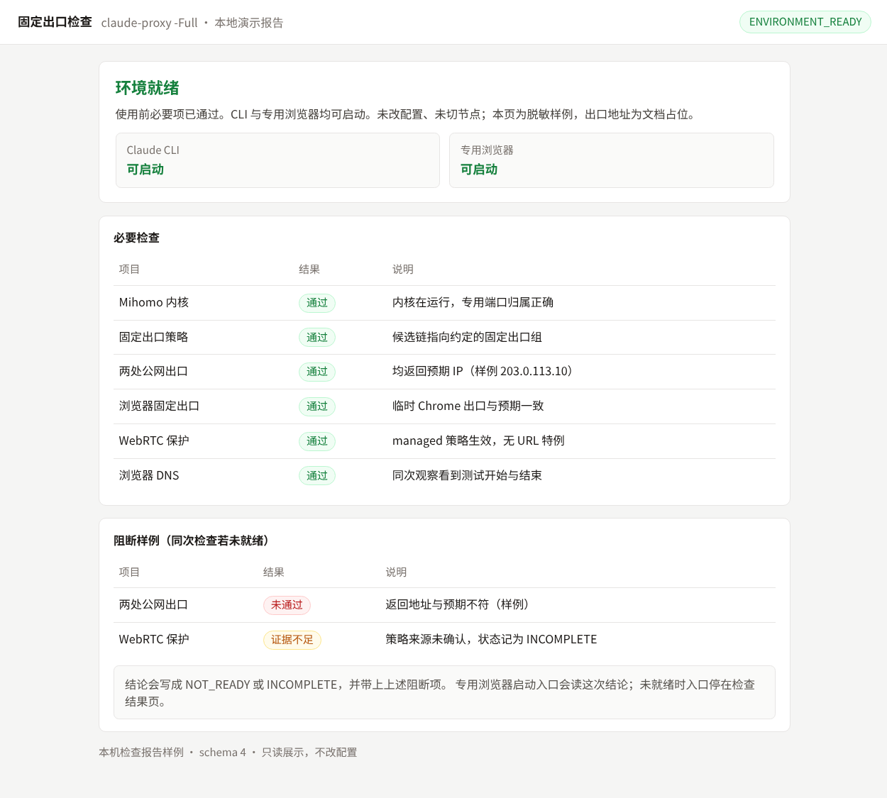

> **公开快照：** 后续开发在 [CC-Guard](https://github.com/1-1-1-11/CC-Guard)。本目录只作历史参考。用户名、安装路径、订阅节点名和 Clash 配置 UID 已换成示例。

> **已归档（2026-10-12）**：本项目已被 Proxy v2 取代，安装目录里运行的是 v2。这里只作历史参考；`Deploy-ClaudeAudit.ps1` 和 `Validate-ClaudeAudit.ps1` 已停用，运行会直接报错退出，以免把旧版装回去。最终状态见标签 `v1-final`。

# Proxy：Claude 固定出口

在这台 Windows 工作站上，让 Claude 始终经指定代理、从固定公网 IP 访问。条件不满足时阻断访问并明确告知，不悄悄直连、不切换出口；使用前就能知道能不能用，出问题时知道怎么恢复。

版本 `2026.10.07.2`。**这是为原工作站定制的工具，不是通用安装包**：路径、端口、节点名和恢复逻辑都按本机编写，迁移前要先看「迁移须知」。



上面是脱敏后的报告页样例（`assets/status.html`），用来对照结论、门禁状态和逐项结果。

## 日常使用

**两种模式**：用 Clash Verge 托盘菜单里的「虚拟网卡模式」开关切换。两种模式下 Clash 都保持「规则」模式并保持运行，系统代理建议一直开着。

| | Claude 模式（虚拟网卡开） | 国内模式（虚拟网卡关） |
| --- | --- | --- |
| 国内 App（三角洲行动、飞书等） | 按规则直连 | 正常使用，等同于关闭 VPN |
| CLI / VS Code / 专用浏览器 | 固定出口 | 固定出口（专用端口与虚拟网卡无关） |
| 桌面端 / 普通浏览器 | 按规则进入固定出口 | 不受保护 |

**看状态**：右下角的状态图标，开机自动显示。

| 图标 | 含义 |
| --- | --- |
| 绿 C | Claude 模式，可以使用 |
| 蓝「国」 | 国内模式，CLI / VS Code / 专用浏览器可以使用 |
| 橙 … | 出口暂未确认，正在复查；或检测已恢复，等待第二轮成功 |
| 红 ! | 固定出口连续两轮检测失败、IP 不符已阻断、守护异常，或 Clash 模式异常 |
| 灰 | 没有网络 |

- 右键可以看到各入口的状态和上次核对时间，还能打开 Clash Verge、做完整检查、打开专用浏览器。
- 单次检测失败和恢复观察不弹提示；连续两轮失败通知一次，之后连续两轮成功再通知恢复。IP 不符、守护停止、状态过期和模式异常仍立即告警。
- 图标每 5 秒刷新，但失败/成功计数只由后台每轮实际检测更新，同一份结果不会重复计数。

**入口**：

| 入口 | 用途 |
| --- | --- |
| 终端里直接运行 `claude` 或 VS Code 插件 | `~/.claude/settings.json` 已把代理固定到专用端口，不需要额外操作 |
| 桌面「Claude CLI 固定出口」 | 先检查当前目录的设置和出口，通过后才启动 CLI |
| 桌面「Claude 专用浏览器」/「Claude 打开授权链接」 | 网页版只用它。每次打开前检查固定出口和 WebRTC 防护，不通过就不打开 |
| 桌面「代理网络检查」 | 完整检查（约 1 分钟），按入口列出能不能用 |

**检查命令**：

```powershell
claude-proxy           # 使用前检查，几秒钟；结束后可选 R 修复 / D 详情 / C 重查 / Q 结束
claude-proxy -Full     # 另启临时未登录 Chrome，提前检查网页版
claude-proxy -Details  # 显示逐项证据
claude-proxy -Repair   # 恢复本机受管理的代理配置并重新检查（可能重启 Clash）
```

输出示例：

```text
结论：可以使用 Claude
当前模式：Claude 模式（虚拟网卡开）
  CLI：可以使用
  VS Code：可以使用
  网页版：未检查：打开「Claude 专用浏览器」时会自动检查
  桌面端：未安装
固定出口：203.0.113.10；独立检测 2/2 通过
状态：ENVIRONMENT_READY；退出码 0
```

不能使用时，每条「原因」下面会给出一行「处理」。更完整的白话说明见 [使用说明](claude-network/使用说明.txt)。

## 怎么做到的

| 层 | 作用 | 位置 |
| --- | --- | --- |
| 数据面 | Clash 专用端口 `127.0.0.1:17892` 固定连到「Claude-固定出口」组，组里只有「固定出口链路」和 `REJECT`。所有备用链路都通往同一台固定 IP 的 SOCKS5 服务器，没有直连兜底。端口或链路不可用时请求直接失败。规则还把 Anthropic / Claude 域名和 `claude.exe` 进程导向同一组。 | `routing-baseline.js`（Clash Verge 脚本） |
| 客户端 | Claude 用户设置和 VS Code 设置的代理指向 17892；`BROWSER` 指向专用浏览器启动器。专用浏览器带 `--proxy-server`，并关闭 QUIC、非代理 UDP 和投屏发现。 | `browser_entry.py`、`ClaudeBrowser.cs` |
| 使用中守护 | 约每 30 秒经 17892 核对出口。IP 不符时把 Claude、Google、X 固定出口组切为 `REJECT` 并断开已有连接，一直保持到显式修复，同时弹窗提醒；Clash 离开规则模式时也会弹窗。`guard.ps1` 每 30 秒确认它在运行，不在就重新拉起。 | `CodexNetworkGuard/` |
| 状态图标 | 每 5 秒读取守护的状态文件和互斥量，显示模式与可用性。不发网络请求，也不改任何设置。 | `ClaudeStatus.cs` |
| 使用前检查 | 核对 Clash 内核与端口归属、固定出口策略、两处独立公网检测、实际路由、守护状态、Claude / VS Code 设置；`-Full` 另用临时 Chrome 检查网页出口、WebRTC 和 DNS。结果按入口给出。 | `audit_proxy.py`、`audit_settings.py`、`audit_browser.py`、`webrtc_probe.py` |
| 修复 | 恢复受管理的 Clash 配置、代理组和客户端设置。先经只供检查用的 `127.0.0.1:17893` 核对出口，正确才放开 Claude；不符或无法确认时继续阻断。 | `repair_proxy.py`、`audit_actions.py` |

**网页版的 WebRTC 判定**：Chrome 实际生效的设置必须是 `disable_non_proxied_udp`，且没有按网址的例外；独立 STUN 对照有响应，浏览器原生 ICE 完成，没有异常候选地址，也没有发出 STUN UDP。设置来源接受两种：

- Chrome 强制策略；
- 命令行设置，并且专用浏览器资料里没有能改写该设置的扩展（持有 `privacy` 权限或存有 WebRTC 偏好）。

专用资料登录 Google 账号后，扩展会随同步进入，所以每次打开都会重新核查。

**结果与退出码**：

| 状态 / 退出码 | 含义 |
| --- | --- |
| `ENVIRONMENT_READY / 0` | 使用前检查通过；各入口以输出列表或 JSON `entries` 为准 |
| `LAUNCH_READY / 0` | CLI 启动条件满足（只看 CLI 相关项） |
| `PROXY_READY / 0` | 网络预检通过，供专用浏览器入口使用 |
| `CLAUDE_OBSERVED / 0` | 仅 `-Runtime`：运行中的 Claude 实例都已关联到真实请求 |
| `NOT_READY / 2` | 存在明确问题 |
| `INCOMPLETE / 3` | 证据不足，不把未知当成通过 |

## 仓库结构

| 路径 | 内容 |
| --- | --- |
| `claude-network/audit_proxy.py` | 检查入口、判定与输出 |
| `claude-network/audit_settings.py` | Claude / VS Code / 环境变量等配置检查 |
| `claude-network/audit_browser.py`、`webrtc_probe.py`、`stun_probe.py` | 临时浏览器的出口、WebRTC、DNS 检查 |
| `claude-network/audit_actions.py` | 菜单修复方案：恢复配置、启动守护、Chrome 单值策略（含备份与回滚） |
| `claude-network/repair_proxy.py`、`repair_support.py`、`repair_jsonc.cjs`、`route_verify.py` | 恢复后端 |
| `claude-network/routing-baseline.js` | Clash 路由基线，同时管理 Google、X、OpenAI 分流 |
| `claude-network/network_check.py` | 守护、修复和浏览器入口共用的出口探测 |
| `claude-network/browser_entry.py`、`ClaudeBrowser.cs`、`Open-ClaudeBrowser.ps1` | 专用浏览器门禁与启动器 |
| `claude-network/ClaudeStatus.cs` | 托盘状态图标 |
| `claude-network/claude-fixed.cmd`、`claude-proxy.cmd`、`Repair-ClaudeProxy.ps1`、`Network-Check.cmd` | 命令与桌面入口 |
| `claude-network/test_*.py` | 离线回归测试 |
| `claude-network/vendor/jsonc-parser/` | JSONC 解析器（MIT 许可证） |
| `CodexNetworkGuard/` | 使用中守护：`health_monitor.py`、`guard.ps1`、`run-hidden.vbs`。`guard.ps1` 还维护 Codex 的代理设置 |
| `Build-ClaudeBrowser.ps1`、`Build-ClaudeStatus.ps1` | 用系统自带的 .NET Framework 编译器生成两个 exe |
| `Deploy-ClaudeAudit.ps1` | 把仓库文件增量部署到已有安装（先备份，不重启进程） |
| `Validate-ClaudeAudit.ps1` | 跑一次检查，并确认配置和 Clash 进程保持不变 |

## 构建、测试与部署（本机）

```powershell
py -m pip install -r requirements.txt          # psutil、PyYAML、playwright；Python ≥ 3.11
py -X utf8 -B -m unittest discover -s .\claude-network -p "test_*.py"
powershell -NoProfile -ExecutionPolicy Bypass -File .\Build-ClaudeBrowser.ps1
powershell -NoProfile -ExecutionPolicy Bypass -File .\Build-ClaudeStatus.ps1
powershell -NoProfile -ExecutionPolicy Bypass -File .\claude-network\Test-ClaudeStatus.ps1
powershell -NoProfile -ExecutionPolicy Bypass -File .\Deploy-ClaudeAudit.ps1
```

- 测试需要本机的 `claude-network/audit_policy.json`（从 `audit_policy.example.json` 复制，再改成自己的固定 IP），不需要运行 Clash，也不需要登录 Claude。
- 部署目标：`%USERPROFILE%\.codex\ClaudeNetwork`（检查与修复）和 `%USERPROFILE%\.codex\CodexNetworkGuard`（守护）。
- 部署后要重启 `guard.ps1` 和守护进程才会加载新代码；路由基线有改动时，需运行一次 `claude-proxy -Repair` 写入 Clash。
- 开机启动项：`CodexNetworkGuard.lnk`（守护）、`ClaudeStatus.lnk`（状态图标）。

## 迁移须知

公开快照里的路径、用户名、节点名和 Clash 配置 UID 都是示例，不是原来那台电脑上的值。

| 项目 | 本机约定 |
| --- | --- |
| Python | `C:\Tools\Python\python.exe` / `pythonw.exe` 写在命令入口、C# 启动器和 `guard.ps1` 里 |
| Clash | Clash Verge Rev（示例目录 `C:\Tools\ClashVerge`）及其 `verge-mihomo-production-*` 命名管道；公开快照里的配置 UID 是 `example-profile` / `example-script` / `example-prepend`，前置节点名是 `Example-JP-HY2` 这一组；端口为 17892（专用）、17893（检查）、7892（日常） |
| 固定出口 | 预期 IP、端口和组名写在 `audit_policy.json`；部分脚本里仍有写死的端口和组名 |
| 用户与路径 | `C:\Users\example`、`C:\Users\example\Desktop`；守护和图标的互斥量名带 `example` |
| Chrome | `C:\Program Files\Google\Chrome\Application\chrome.exe`，专用资料在 `%LOCALAPPDATA%\ClaudeNetwork\ChromeData` |
| 恢复 | 需要本机的 `repair-baseline.dpapi`（跟随 Windows 用户，不能跨机）、现有 Clash 配置和凭据、Node.js。它不是首次安装工具 |

## 域名补漏（本机，2026-10-08）

- 根据 [Claude 官方网络要求](https://code.claude.com/docs/en/desktop#network-access-requirements)，新增 `claudemcpcontent.com`（交互式 MCP 内容）和 `claude.app`（含预览内容子域名）的后缀规则，均进入 `Claude-固定出口`。
- Auth0 核查：当前公共入口的 `auth0.com` 规则仍指向 OpenAI 日常代理；本机 Claude Code 2.1.293、现有日志和当时活动连接中未发现 `anthropic.auth0.com`，本次查阅的官方认证清单也未列出它。这不证明所有客户端都不使用该地址；本次没有添加未经确认的 Auth0 例外。
- 仅增加上述两条规则；没有新增宽泛关键词、IP / ASN 规则或直连兜底，原有规则顺序和代理组选择保持不变。
- 201 项现有回归测试通过；规则生成可重复运行。已同步安装脚本和 Clash 当前脚本，并热加载到 Mihomo：运行规则从 3902 条变为 3904 条，内核进程未重启。
- 更新前后分别经专用入口使用 Cloudflare、ipify 核对，均为预期固定出口。本次验证覆盖规则加载和出口，未执行 Claude 登录、模型请求或真实 MCP 内容加载。

## 状态图标修复验证（本机，2026-10-08）

- 修复单轮探测失败立即红色告警、一次恢复立即弹窗的问题；以真实检测轮次确认故障和恢复，硬故障仍立即告警。
- 保留已安装版本的原生图标句柄释放修复，相同图标不重复绘制；健康日志保留主、备出口检测的结果、错误类型和耗时。
- 201 项 Python 回归测试通过，状态判定及通知策略的 105 个离线断言通过。
- 定点更新状态程序和健康监控，Clash 内核 PID 与代理配置校验值保持不变。12:14:47—12:15:55 连续三轮出口检查通过，另经 Cloudflare 与 ipify 独立确认出口一致。
- 这次修复覆盖状态判断和提示；日志中的真实链路超时不能仅靠本次短时通过判定已消除。

## 验证记录（本机，2026-10-07）

- 194 项离线回归测试通过。
- 停掉守护监控后检查返回 `NOT_READY / 2`，`guard.ps1` 当秒重新拉起；守护和监控都停掉时，菜单「启动使用中守护」14.3 秒恢复。
- `claude-proxy -Repair` 先经 17893 两处核对出口为预期 IP，再放开 Claude；17893 实际链路为「静态出口-自动恢复 → 静态IP-链式」。
- `claude-proxy -Full` 为 `ENVIRONMENT_READY / 0`：CLI、VS Code、网页版可用；专用浏览器门禁 `ready`，CLI 门禁 `LAUNCH_READY / 0`。
- 状态图标对 7 种模拟状态及状态文件缺失的判定全部正确。
- **未实测**：真实切换虚拟网卡或 Clash 模式时的图标与弹窗、真实出口变化时的阻断。这些逻辑由离线测试覆盖。

以上只说明当次本机状态，不代表以后，也不代表其他电脑。

## 边界

- 守护约每 30 秒核对一次，出口变化后最多约 30 秒才会阻断。
- Clash 被切到全局或直连时只提醒、不阻断；国内模式下桌面端和普通浏览器里的 Claude 不受保护。
- 不保证账号权益、地区资格、免封禁或供应商永久静态 IP。
- 任意工具、MCP、WSL、SSH 和普通浏览器不在统一出口保证之内。
- 不读取 Cookie，不登录也不调用模型；配置凭据只在内存里比较，不输出、不另存。

## 保存范围

仓库只保存源码、测试、示例策略和文档。`.gitignore` 排除了真实策略 JSON、Clash 配置、DPAPI 文件、浏览器资料、编译出的 exe、快捷方式、部署备份、日志和运行报告。源码里含原工作站的路径和节点名，请按私有仓库保存，不要用 `git add -f` 绕过排除规则。
